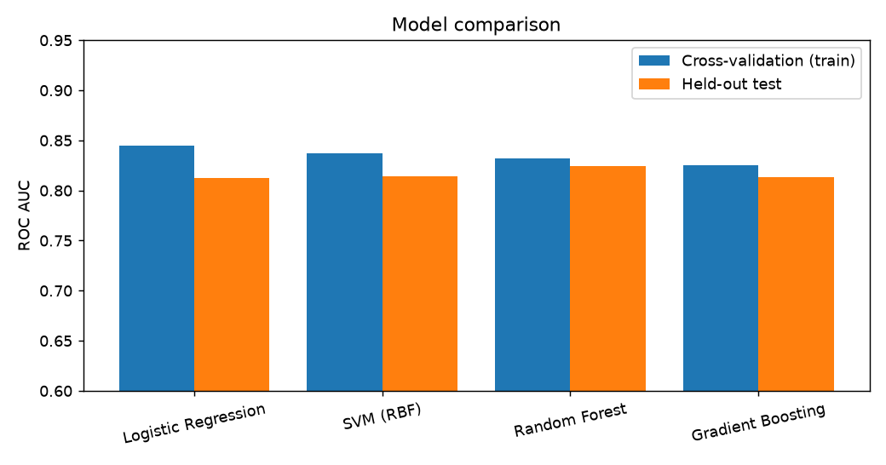
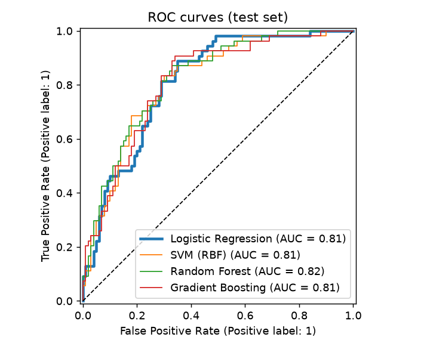
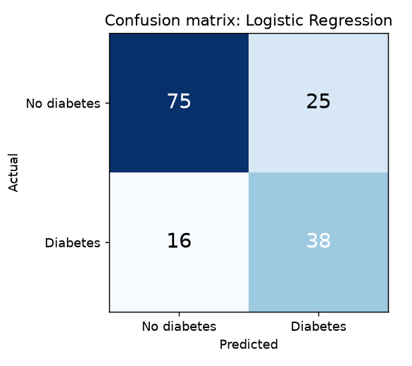
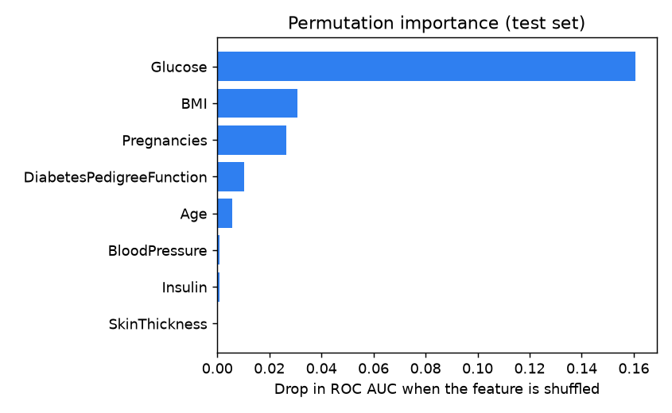

# Diabetes Risk Predictor

A small end-to-end machine learning project: train and compare several models on a public diabetes dataset, then serve the best one through a **FastAPI** REST API with a simple web form.

> **Educational demo.** It is trained on a small public dataset and is not a medical device. It does not replace a doctor.

## What it does

- Trains four models (logistic regression, SVM, random forest, gradient boosting) in one pipeline that handles missing values and scaling
- Picks the best one using **cross-validation on the training data only**, then reports honest scores on a held-out test set
- Serves predictions with `POST /predict` (validated input, automatic API docs at `/docs`)
- Provides a web form at `/` that shows the risk score, model metrics and which features matter most
- Accepts missing measurements: an empty field is replaced by a typical value, just like during training
- Ships with automated tests and a Docker setup that trains the model while building the image

## Quick start

### With Docker

```bash
docker compose up --build
```

Open http://localhost:8000 (API docs at http://localhost:8000/docs). To use another port, set `PORT=8001` in a `.env` file.

### Without Docker (Python 3.12 recommended, the pinned versions were tested on it)

```bash
python -m venv .venv
.venv\Scripts\activate          # Windows. On Linux/macOS: source .venv/bin/activate
pip install -r requirements-dev.txt
python -m risk.train             # trains, saves model/model.joblib and reports/
uvicorn app.main:app --reload
pytest                           # optional: run the tests
```

## Example request

```bash
curl -X POST http://localhost:8000/predict \
  -H "Content-Type: application/json" \
  -d '{"Pregnancies": 2, "Glucose": 138, "BloodPressure": 72, "SkinThickness": null,
       "Insulin": null, "BMI": 33.6, "DiabetesPedigreeFunction": 0.63, "Age": 45}'
```

```json
{
  "probability": 0.65,
  "risk_level": "moderate",
  "missing_inputs": ["SkinThickness", "Insulin"],
  "model": "Logistic Regression",
  "disclaimer": "Educational demo trained on a small public dataset. ..."
}
```

Risk levels: `low` below 0.33, `moderate` from 0.33 to 0.66, `high` above 0.66.

| Route | Description |
|---|---|
| `GET /` | Web form |
| `POST /predict` | Risk score for one profile |
| `GET /model-info` | Model name, metrics, comparison and feature importance |
| `GET /health` | Service status |
| `GET /docs` | Interactive API documentation (Swagger) |

## Data

[Pima Indians Diabetes Database](https://www.kaggle.com/datasets/uciml/pima-indians-diabetes-database) (originally from the National Institute of Diabetes and Digestive and Kidney Diseases): 768 records, 8 measurements each, about 35 % positive. The copy in `data/diabetes.csv` is the commonly shared version with a header row added.

Data cleaning: in five columns (Glucose, BloodPressure, SkinThickness, Insulin, BMI) a value of 0 means "not measured". These zeros are turned into missing values and replaced by the median of the training data.

## Results

Data split: 80 % train (614 rows) and 20 % test (154 rows), stratified, fixed seed. Models are compared by 5-fold cross-validated ROC AUC on the training set. The test set is used once for the final numbers.

| Model | CV ROC AUC | Test ROC AUC | Accuracy | Precision | Recall |
|---|---|---|---|---|---|
| Logistic Regression **(selected)** | 0.844 | 0.813 | 0.734 | 0.603 | 0.704 |
| SVM (RBF) | 0.837 | 0.814 | 0.747 | 0.660 | 0.574 |
| Random Forest | 0.832 | 0.824 | 0.747 | 0.623 | 0.704 |
| Gradient Boosting | 0.825 | 0.813 | 0.721 | 0.622 | 0.518 |

The selected model reaches a test ROC AUC of 0.81. On the 154 test records it finds 38 of 54 diabetic cases and raises 25 false alarms. The most influential features are Glucose, BMI, Pregnancies.






Things worth knowing:
- The four models are close to each other, and the simple logistic regression is competitive. With 768 rows, differences of one or two points are within noise.
- `class_weight="balanced"` is used (where supported) so the models do not ignore the minority class. This raises recall at the cost of precision, which is the usual trade-off for screening.
- Scores are model outputs, **not calibrated real-world probabilities**.

## Limitations

- The dataset contains only women of Pima Indian heritage, aged 21 or more. The model should not be expected to work for other groups.
- 768 records is small, and results change slightly with another split.
- No clinical validation. Do not use it to make health decisions.

## Project structure

```
disease-risk-predictor/
├── risk/
│   ├── features.py      Feature list and zero-to-missing cleaning (shared by training and API)
│   └── train.py         Model comparison, evaluation, saving, plots
├── app/
│   ├── main.py          FastAPI service
│   └── static/index.html  Web form
├── data/diabetes.csv
├── reports/             Metrics and plots from the last training run
├── tests/               API tests (pytest)
├── Dockerfile
├── docker-compose.yml
└── requirements.txt / requirements-dev.txt
```

## Ideas for next steps

- Hyperparameter search and probability calibration
- Explain each individual prediction (for example with SHAP)
- Compare with a larger dataset
- Add a model version and request logging

## License

MIT. The dataset has its own terms, see the source above.
